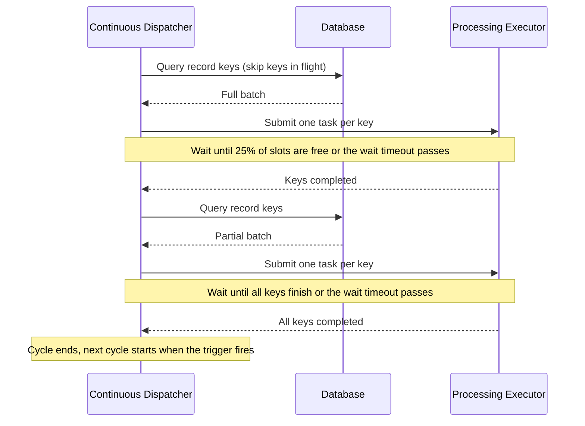

# Polling Strategies

Namastack Outbox uses a polling loop to detect and process pending outbox records. The library
supports two polling strategies — **Fixed** and **Adaptive** — which differ in how the interval
between poll cycles is managed. Choosing the right strategy depends on the predictability and
variability of your outbox write workload.

Within a poll cycle, the [dispatch mode](#dispatch-modes) decides how record keys are selected and
handed to the processing executor.

---

## Fixed Polling

Fixed polling uses a constant interval between poll cycles, regardless of whether the previous
cycle found work to do.

**How it works:**

Each cycle queries the database for record keys with pending records and processes up to
`batch-size` record keys. In the default `batch` [dispatch mode](#dispatch-modes), the scheduler
waits for all key tasks to finish and then waits for the configured interval before starting the
next cycle. Processing time therefore adds to the time between polls.

**Best for:**

- Workloads with predictable, steady throughput (e.g., scheduled jobs, regular event streams)
- Systems where latency consistency is more important than minimizing database queries
- Development and testing environments where simplicity is preferred

**Trade-off:** Fixed polling keeps polling during idle periods instead of increasing the delay.
For workloads with significant idle time, adaptive polling can reduce database traffic.

**Configuration:**

| Property                                  | Default | Description                                                                         |
|-------------------------------------------|---------|-------------------------------------------------------------------------------------|
| `namastack.outbox.polling.trigger`        | `fixed` | Selects the polling strategy                                                        |
| `namastack.outbox.polling.fixed.interval` | `2s`    | Interval between poll cycles. Supports duration strings: `2s`, `500ms`, `1m`        |
| `namastack.outbox.polling.batch-size`     | `10`    | Maximum number of record keys per poll cycle (`batch`) or in flight (`continuous`) |

**Example configuration:**

```yaml
namastack:
  outbox:
    polling:
      trigger: fixed
      batch-size: 20
      fixed:
        interval: 1s
```

---

## Adaptive Polling

Adaptive polling dynamically adjusts the interval between poll cycles based on observed
workload. When the system is busy, it polls more frequently. When it is idle, it backs off to
reduce unnecessary database load.

**How it works:**

After each record key query, the adaptive strategy compares the number of keys found with the
number of keys the query could return (`requested`):

- If **at most 25%** of the requested keys are found (low load), the interval doubles
  (up to `max-interval`)
- If **all** requested keys are found (high load), the interval halves (down to `min-interval`)
- If load is **above 25% and below 100%**, the interval stays the same

In `batch` dispatch mode, `requested` is `batch-size` and the strategy evaluates one query per
poll cycle. In `continuous` dispatch mode, it evaluates every query of a cycle, and `requested`
is the number of free slots at the time of the query.

This means the system converges quickly on the minimum interval during bursts, and gradually
backs off to the maximum interval during quiet periods.

**Best for:**

- Workloads with variable throughput (e.g., user-triggered events, mixed traffic patterns)
- Production systems where database query cost matters
- Systems with significant idle periods between activity bursts

**Trade-off:** During sudden traffic spikes, adaptive polling may take a few cycles to converge
on the minimum interval, adding a small amount of initial latency compared to Fixed polling.

**Configuration:**

| Property                                         | Default    | Description                                                                         |
|--------------------------------------------------|------------|-------------------------------------------------------------------------------------|
| `namastack.outbox.polling.trigger`               | `fixed`    | Set to `adaptive` to enable adaptive polling                                        |
| `namastack.outbox.polling.adaptive.min-interval` | `1s`       | Minimum interval between polling cycles (floor during high load)                    |
| `namastack.outbox.polling.adaptive.max-interval` | `8s`       | Maximum interval between polling cycles (ceiling during idle)                       |
| `namastack.outbox.polling.batch-size`            | `10`       | Maximum number of record keys per poll cycle (`batch`) or in flight (`continuous`) |

**Example configuration:**

```yaml
namastack:
  outbox:
    polling:
      trigger: adaptive
      batch-size: 20
      adaptive:
        min-interval: 500ms
        max-interval: 30s
```

`min-interval` must be at least `1ms`, and `max-interval` must not be less than `min-interval`.
The application fails to start otherwise.

**Polling again right after a full batch:**

With `min-interval: 1ms`, the next poll cycle starts almost immediately while batches are full,
instead of waiting for a fixed interval:

```yaml
namastack:
  outbox:
    polling:
      trigger: adaptive
      adaptive:
        min-interval: 1ms
        max-interval: 8s
```

Keep the following in mind with this configuration:

- After an idle period, the interval halves once per full batch, so it takes about 12 full
  batches to go from `8s` down to `1ms`.
- Under medium load (more than 25% but less than 100% of `batch-size`), the interval stays at
  `1ms`, so the instance polls the database almost continuously.
- When idle, the interval doubles back up to `max-interval`.
- In `batch` dispatch mode, each poll cycle waits for all record keys of its batch to complete
  before the next cycle starts. To refill free capacity while slow keys are still running, use
  [continuous dispatch](#continuous-dispatch).

---

## Dispatch Modes

:::info Available since 2.0.0
Dispatch modes are available since version 2.0.0.
:::

The dispatch mode controls how a poll cycle selects record keys and submits them to the
processing executor. Both modes keep records of one key in order, process a key on at most one
thread of an instance at a time, and apply `processing.stop-on-first-failure` in the same way.

| Property                                    | Default | Description                                     |
|---------------------------------------------|---------|-------------------------------------------------|
| `namastack.outbox.processing.dispatch-mode` | `batch` | How record keys are dispatched: `batch` or `continuous` |

### Batch Dispatch

`batch` is the default. A poll cycle selects up to `batch-size` record keys, submits one task per
key, and waits for every task to finish. The next cycle starts when the polling trigger fires.

A slow key holds the whole cycle: the other keys of the batch finish, their capacity stays idle,
and no new keys are selected until the slowest key completes.

### Continuous Dispatch

`continuous` keeps up to `batch-size` record keys in flight and selects new keys while other keys
of the cycle are still processed:

```yaml
namastack:
  outbox:
    processing:
      dispatch-mode: continuous
```

**How it works:**

Each fetch queries record keys, skips keys that are already in flight, and submits at most one
key per free slot. A key stays in flight until its task has finished. With
[completion batching](database.md#completion-batching), that includes the acknowledged completion commit. After each
fetch, the cycle continues by the size of the fetched batch:

- **Empty batch** with no key in flight: the cycle ends.
- **Partial batch** (fewer keys than free slots): wait until every key in flight has finished,
  which ends the cycle, or until the wait timeout passes, then fetch again.
- **Full batch** (a key for every free slot): wait until a quarter of `batch-size` slots are free
  (at least one), or until the wait timeout passes, then fetch again.

The wait timeout is the polling trigger's current delay: `polling.fixed.interval` with fixed
polling, or the current adaptive delay. Records that arrive while only slow keys are in flight
are therefore picked up within one polling interval.



**When a cycle stops fetching:**

A continuous cycle stops selecting new keys when:

- a partition rebalance is due, so under sustained load a cycle ends about once per
  `instance.rebalance-interval`
- the application shuts down
- a handler or payload type is unavailable on this instance and a compatibility cooldown starts

Keys already submitted always finish before the cycle releases its partition assignment. The next
cycle starts when the polling trigger fires.

**When to use it:**

- Handler durations vary, and a few slow keys should not hold capacity for fast keys
- New records should be picked up while slow keys of the same cycle are still running

Continuous dispatch only reuses free capacity. When every slot holds a slow key, it behaves like
batch dispatch. Under load it runs more key queries with smaller record loads than batch dispatch,
about one query per quarter of `batch-size` completed keys. With platform threads, keep
`batch-size` above `processing.executor-core-pool-size` so threads stay busy between refills; the
defaults (`10` and `4`) already do so.

---

## Choosing a Strategy

| Criterion                          | Fixed             | Adaptive            |
|------------------------------------|-------------------|---------------------|
| Workload is steady and predictable | ✅ Preferred       | Works               |
| Workload is bursty or idle-heavy   | Works             | ✅ Preferred         |
| Minimizing database queries        | —                 | ✅ Better            |
| Minimizing processing latency      | ✅ More consistent | Adds warmup latency |
| Simplicity of configuration        | ✅ One parameter   | Two parameters      |

Choose **Adaptive** to reduce idle queries or **Fixed** for a predictable delay between cycles.
Neither strategy guarantees a maximum delivery latency: processing time, backlog, retries, and
database availability also affect it.

Both strategies work with both dispatch modes. Choose **continuous** dispatch when handler
durations vary widely and slow keys would otherwise hold back a batch.

:::tip Related Configuration
The `batch-size` property affects how quickly the adaptive strategy reacts to load changes.
A larger batch size means the strategy is less sensitive to small bursts. See
[Processing Chain](processing.md) for how records are processed within each batch.
:::
